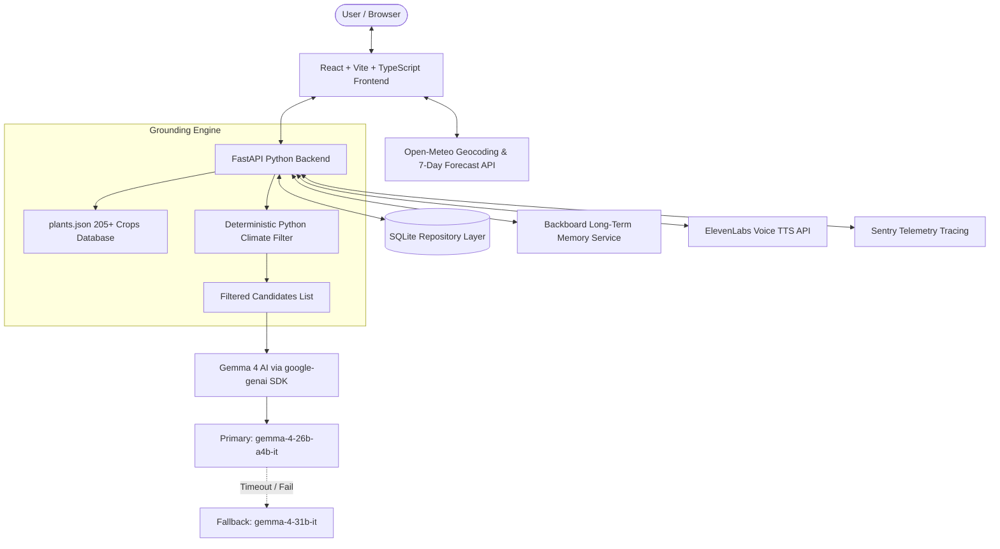

# GrowThisWeek 🌱 — Grounded AI Garden Planner
#HackDay-koperkhairne

[](https://dev.to)
[](https://fastapi.tiangolo.com)
[](https://vitejs.dev)
[-4285F4.svg)](https://ai.google.dev)
[](LICENSE)

**GrowThisWeek** is a beautiful, weather-reactive AI garden planner created for the **Hacktoberfest Open-Source AI Challenge on DEV**. It reads real 7-day climate forecasts from Open-Meteo and uses an open-source AI model (**Gemma 4**) to generate personalized, grounded recommendations for what to plant, what to avoid, and how to protect plants each week.

---

## 🏛️ System Architecture



---

## ✨ Features Checklist

### Must-Have Core
- 🌆 **City Search & Geolocation:** Autocomplete city lookup powered by Open-Meteo geocoding plus browser geolocation.
- 🌤️ **7-Day Weather Dashboard:** Animated cards displaying temperature min/max, precipitation sum & probability, wind speed, UV index, and humidity.
- 📋 **This Week's Plan:** Grounded recommendation cards, "Why this plant?" climate math explainer, "Avoid this week" & "Protect" alert banners.
- 🔬 **Why This Plant? Explainer:** Shows the exact temperature and rainfall numbers used by the Grounding Engine.
- 🧙‍♂️ **3-Step Onboarding:** City, garden space (balcony, terrace, ground, indoor), and experience level customization.
- 🌿 **My Garden Tracker:** Active crop management, growth stage progress bars, and harvest countdowns.
- ⚡ **10-Second Demo Mode:** One-click prefilled sample garden for judge evaluation.

### Smart AI & Botanical Tools
- 🩺 **Plant Doctor (Vision AI):** Upload/capture sick plant photo to identify pests/diseases with confidence % and organic low-cost treatment steps.
- 📐 **Space Scanner (Vision AI):** Photo analysis of balcony or yard space estimating sunlight hours and grow container compatibility.
- 💬 **Ask Gemma Grounded Chat:** AI assistant with prompt chips grounded in active weather and memory history.
- 🔊 **Voice TTS:** "Listen to today's tip" audio button powered by ElevenLabs with local disk hash caching.
- 🛡️ **Water Saver:** Rainwater offset calculator and days-to-skip watering schedule.
- 🎯 **"What If" Climate Simulator:** Drag temperature and rainfall sliders to test real-time re-grounding.
- 📊 **Under The Hood Dashboard:** Hidden observability page displaying AI call latencies, token counts, model fallback usage, and Sentry traces.
- 📅 **Garden Calendar Export:** One-click `.ics` calendar file download for sowing and watering routines.
- 🖼️ **Shareable Plan Card & PDF Print:** Generate downloadable weekly plan image cards or print formatted PDF schedules.

---

## 🛠️ Technology Stack

| Layer | Technology |
|---|---|
| **Backend Framework** | Python 3.10+, FastAPI, Pydantic v2, Uvicorn |
| **AI Model & SDK** | Gemma 4 (`gemma-4-26b-a4b-it` & `gemma-4-31b-it`) via `google-genai` (v2.3.0+) |
| **Frontend Framework** | React 18, Vite, TypeScript, Tailwind CSS, Framer Motion, Lucide Icons |
| **Weather API** | Open-Meteo API (Geocoding & Forecast, free, no key required) |
| **Memory Service** | Backboard API (with local SQLite fallback) |
| **Voice Synthesis** | ElevenLabs TTS (with MD5 disk hash caching) |
| **Database** | SQLite3 behind repository layer |
| **Telemetry & Observability** | Sentry SDK + custom trace logging |

---

## 🚀 Quickstart & Local Setup

### 1. Prerequisites
- Python 3.10 or newer installed
- Node.js 18+ and npm installed

### 2. Clone & Setup Backend
```bash
# Clone the repository
git clone https://github.com/your-username/grow-this-week.git
cd grow-this-week

# Copy environment template
cp .env.example .env

# Install Python requirements
pip install -r requirements.txt

# Run plant generator (if generating database)
python app/data/generate_plants.py
```

### 3. Setup Frontend
```bash
cd frontend
npm install
npm run build
cd ..
```

### 4. Run Locally
```bash
# Start FastAPI backend (which also serves the built frontend)
uvicorn app.main:app --host 0.0.0.0 --port 8000 --reload
```
Open your browser at `http://localhost:8000`.

---

## 🧪 Evaluation & Quality Benchmark

Run the automated evaluation suite testing 10 cities and 5 photo scenarios:
```bash
python evals/run_evals.py
```
View generated benchmark results in `evals/REPORT.md`.

---

## 📄 License

Distributed under the **MIT License**. See `LICENSE` for details.
